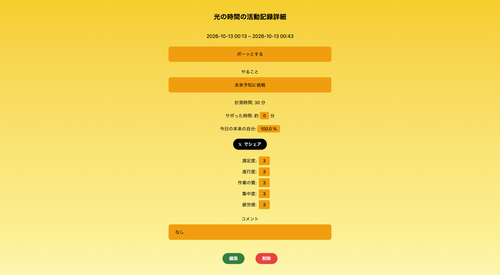
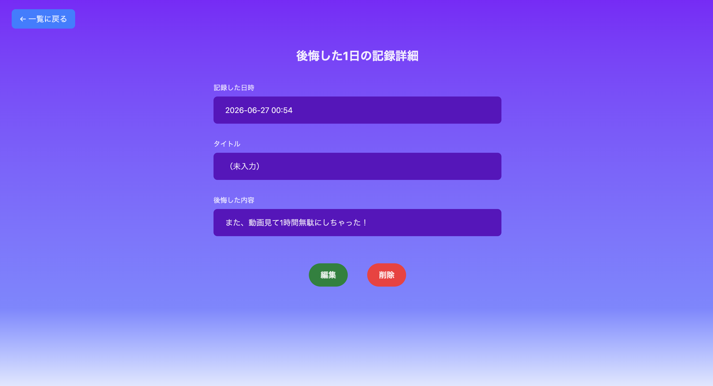
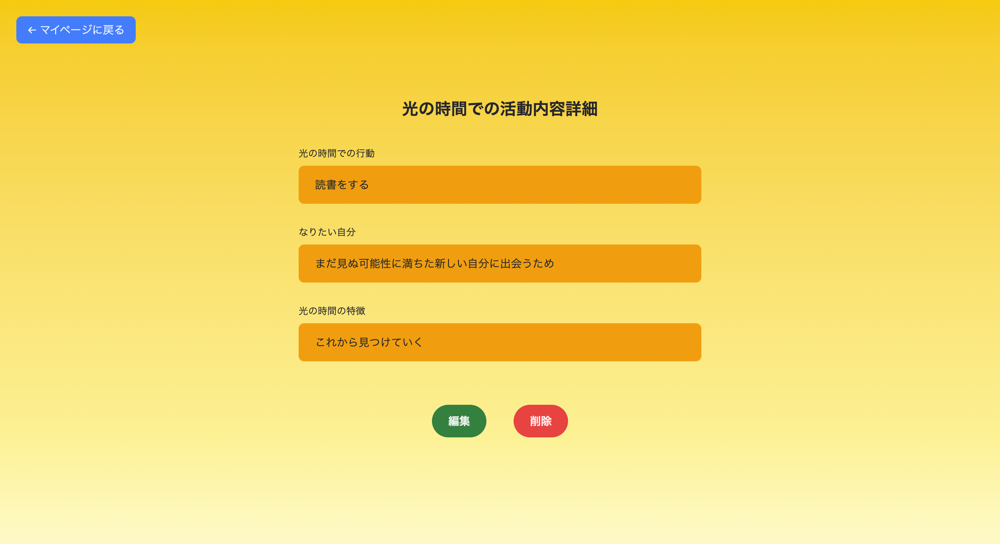
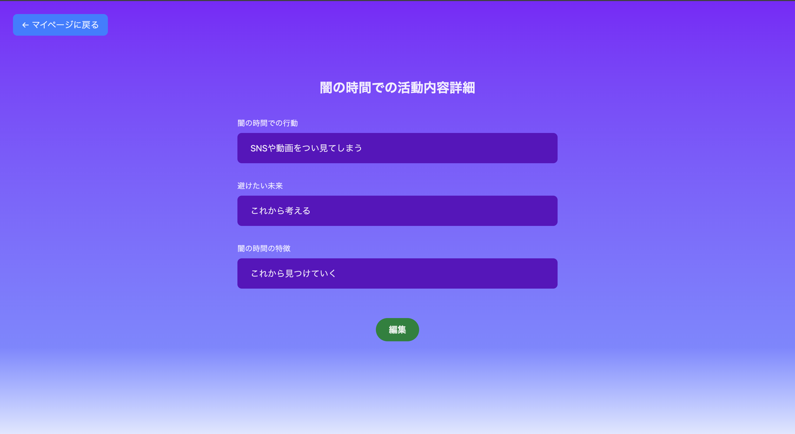
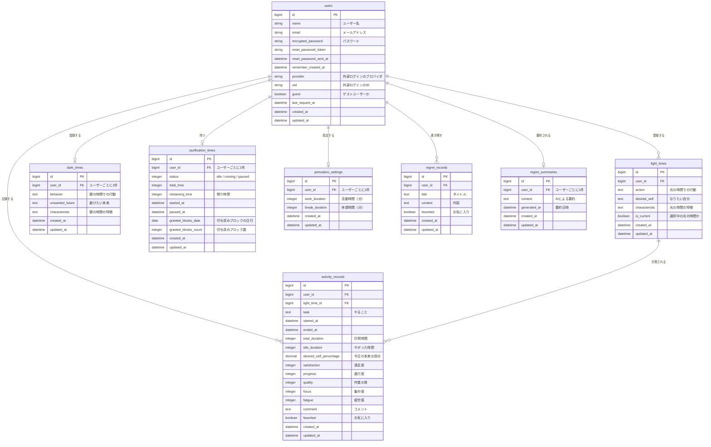

# Get The Time ー 本来の自分を手に入れろ ー


## アプリURL
https://get-the-time.com/

ゲストログインから、登録なしですぐにお試しいただけます。

## サービス概要
**Get The Time** は、学校や仕事、家事などが終わった後の自由時間を、次の 2 つに分けて整理するアプリです。

- **光の時間**：本来望んでいる行動をしている時間（例：勉強、副業、読書など）
- **闇の時間**：望んでいないのに、ついやってしまう行動をしている時間（例：SNS、動画、ゲーム、ネットサーフィンなど）

光の時間をポモドーロタイマーで計測し、その中でサボった時間を記録することで、「**本来の自分**」を数値で振り返ります。

```math
\text{本来の自分}=\frac{\text{光の時間}-\text{サボった時間}}{\text{光の時間}}.
```

本来の自分は、「自由時間の中でどのくらい自分自身を裏切らずに向き合えたか（自己像の形成度合い）」を表す指標です。
また、頑張った分だけ娯楽に使える「**浄化タイマー**（正当な報酬）」が付与されるため、罪悪感なく休むことができます。
光と闇の時間のバランスを取りながら、望んでいる本来の自分に出会うためのサービスです。

## 主な機能

### 1. マイページからタイマースタート
マイページには、なりたい自分と避けたい未来が常に表示されます。取り組む光の時間を選んでスタートボタンを押すと、ポモドーロタイマーが始まります。

<!-- VIDEO: transfer_activity_time -->

### 2. 休憩時間への遷移
活動時間が終わると、自動で休憩時間のタイマーに切り替わります。活動時間・休憩時間はマイページから設定できます（初期値は活動 25 分・休憩 5 分）。

<!-- VIDEO: transfer_break_time -->

### 3. タイマー終了から活動記録の作成
タイマーを終了すると、活動記録の入力画面に移ります。サボった時間と、満足度・進行度・作業の質・集中度・疲労感の 5 段階評価を記録します。取り組みの中で気づいた「光の時間の特徴」「闇の時間の特徴」もここで更新できます。

<!-- VIDEO: create_activity_record -->

### 4. 活動記録の詳細で「今日の本来の自分」を振り返る
記録した活動の詳細画面には、計測時間とサボった時間から算出した「**今日の本来の自分**」を表示しています。その日の自分がどれだけ望む行動に向き合えたかを、記録を見返すたびに振り返れるようにするためです。気づきがあればコメントを追記でき、結果は X でシェアできます。



### 5. 浄化タイマー
その日の光の時間が累計 30 分たまるごとに、8〜15 分の浄化タイマーが付与されます。浄化タイマーの間は、SNS や動画などの娯楽を罪悪感なく楽しめます。累計は 0 時にリセットされ、マイページで次の付与までの残り時間を確認できます。

<!-- VIDEO: purification_time -->

### 6. マイステータスの振り返り
直近 2 週間の記録から、光の時間の推移、本来の自分の平均、評価項目のレーダーチャート、疲労感の平均をグラフで確認できます。本来の自分は X でシェアできます。

<!-- VIDEO: mystatus_reflection -->

### 7. 後悔した 1 日の記録と AI による要約
「後悔した 1 日を過ごしてしまった」と思ったら、その日のことを書き残せます。お気に入りに登録した記録をもとに、闇の時間に陥りやすい傾向を AI が要約し、ボタン 1 つで闇の時間の特徴へ追記できます。

<!-- VIDEO: regret_summary -->



### 8. 光の時間・闇の時間の詳細
光の時間にはなりたい自分を、闇の時間には避けたい未来を登録します。活動記録や AI の要約を通して書き足した「特徴」がここに蓄積され、自分の行動パターンを見返せます。

| 光の時間の詳細 | 闇の時間の詳細 |
|---|---|
|  |  |

## このサービスへの思い・作りたい理由
学校が終わった後、「やった！休みだ！この後自由だ！！！」と思って
帰宅後、SNSやYoutubeばかり見たりゲームしたりして、気がついたら

「せっかくの帰宅後の時間や休日等の自由時間を無駄に過ごしてしまった！」

「本当は読書や資格、技術の勉強などをして有効に時間を活用したかった！」

こんな後悔する日々を日常的に経験していました。

現代社会においても、リスキリングという言葉が当たり前となっており、学生のみならず社会人にも「学び直し」「スキルアップ」「自己投資」が求められる時代になっております。
しかしながら、SNS・映像メディア普及の影響により、誘惑に負けて「本来こうしたいのにできない」という矛盾した気持ちを抱く方が増えていることが予測されます。

この矛盾した気持ちを解消するためには、次の3つの要素を同時に満たす必要があるのではないかと思っております：
1. 望んだ行動ができるようになってどのような自分に変わるのか明確にし、普段から想起できるようにする
2. 望んでいる行動をポモドーロ・テクニックにより体現する
3. 娯楽の時間を正しく把握してとる

根拠としては、個人的な体験になるのですが、現在までプログラミング学習が継続できているのは、「多くの方の日常生活に貢献できるWebアプリケーションを作成できるWebエンジニアになりたい」という理想のエンジニア像が明確にあるからだと思っております。
学習中にSNSや動画を見ようと思った時、将来なりたい理想のエンジニア像を思い出すことで、誘惑に負ける行動が抑制されていることがありました。
その目標に向かって学習時間を計測して取り組んでいくことで、日々の学習の記録が実績として積み重なって自信につながっております。
ただし、日々過ごす中で、アニメやゲーム、SNS、動画を見る時間をどのくらいとればよいのかわからなくなることがあります。
学習時間外においても、こうした娯楽の時間をとろうとすると、罪悪感を感じて心理的負担につながることが度々あります。
そのため、バランスの取れた時間管理を行うことで、問題解決につながると思っております。

上記三点のプロセスを正しく踏むことにより、本来望んでいる自己像が形成されることで、
「悪習慣と後悔の念を繰り返す日常を失くし、本来望んでいることに時間を有効に活用できる」
のではないかと思い、**Get The Time** を実現することにしました。

## 想定ユーザー
「**本来こうしたいのに誘惑に負けてできない自分**」に苦しんでいる人を想定しております。

- 学校が終わった後や休日、勉強したいと思ってもできない学生、受験生
- 仕事や家事が終わって一日の残り時間や休日を自己投資時間に活用したい社会人、主婦、主夫
- 仕事とプライベートの境界が曖昧な在宅ワーカー・フリーランス
- 休憩することに罪悪感を感じてしまい、結果的に燃え尽きてしまう完璧主義で疲れやすい人
- スマホ依存・先延ばしに悩んでいる人
- 習慣化アプリや日記が続かなかった人

## サービスの差別化ポイント・推しポイント
機能を考慮すると、「時間管理」「集中」「習慣化」アプリが類似のサービスとして挙げられます。
以下の表が、各々の特徴をまとめたものになります：

| アプリ | 例 | 解決したい問題 |
|---|---|---|
| 時間管理アプリ | Google Calendar | 時間をどのように配分するのか |
| 集中アプリ | Forest、Focus To-Do、ポモドーロタイマーアプリ | 目の前の作業に集中させる |
| 習慣化アプリ | Habitica | 行動を継続させる |

**Get The Time** のテーマは、「本来望んでいる自己像に結びつく自由時間の正しい使い方とは」です。いずれのアプリとも根本的に解決したい問題が異なっているため、この点で差別化できていると思われます。

## ユーザーの獲得について
- 「#今日の本来の自分」や「#本来の自分」というハッシュタグで、各々今日の本来の自分、ステータスでの本来の自分をXに投稿できるシェア機能を搭載。
- noteを使って具体的な活用方法を宣伝する。

## 使用技術
| カテゴリ | 技術 |
|---|---|
| バックエンド | Ruby 3.3.6 / Ruby on Rails 8.1.3.1 |
| フロントエンド | Hotwire (Turbo / Stimulus) / esbuild / Tailwind CSS v4 / Chart.js |
| データベース | PostgreSQL (Neon) |
| バックグラウンド処理など | Solid Queue / Solid Cache / Solid Cable |
| 認証 | Devise / OmniAuth (Google ログイン) |
| 検索・ページネーション | Ransack / Kaminari |
| 外部 API | OpenAI API（後悔した 1 日の要約） / Resend（メール送信） |
| テスト・静的解析 | RSpec / FactoryBot / Capybara / RuboCop / Brakeman |
| 開発環境 | Docker (Docker Compose) |
| CI / デプロイ | GitHub Actions / Render |

## 画面遷移図
Figma：https://www.figma.com/design/IPuZKnOO8Oj3byb8qIBjl7/Get-The-Time?node-id=0-1&p=f&t=kPar2A1oObmgWZZ5-0

## ER図



## 詳細な仕様

<details>
<summary>このサービスにおける時間の定義</summary>

### 1. 拘束時間
日常でやらなければならないと認識して取り組んでいる時間。日常でやらなければならないこととして、主に仕事や学校、食事、風呂、歯磨き、睡眠、その他義務的にやっていること等が該当する。原則、アプリを利用しない時間帯である。ただし、宿題等改善したいものがあれば、下記の光の時間として登録することはこの場限りではないものとする。

### 2. アプリ利用自由時間
拘束時間以外のこのサービスを利用する自由時間。下記の光の時間と闇の時間の2種類が存在するものとする：

- 光の時間：本来望んでいる行動をしている時間。また、ポモドーロ・テクニックの休憩時間もこちらに含まれるものとする。

例：勉強、副業、読書など

- 闇の時間：望んでいないついやってしまう行動をしている時間

例：SNS、動画、アニメ、ゲーム、ネットサーフィンなど

- サボった時間：光の時間内の闇の時間

- 浄化時間：光の時間外の闇の時間。光の時間とバランスを取るための目安時間として使われる。浄化タイマーとして利用できる。

### 3. その他の時間
このサービスを利用しない自由時間。主に、このサービスに依存しないリラックスやのんびりする時間、このサービスを利用しない間の闇の時間等が該当する。ただし、リラックスやのんびりする時間について、「完璧主義で疲れやすいのを克服したい」、「スマホ依存を改善したい」等の目的で、光の時間として登録することはこの場限りではないものとする。

</details>

<details>
<summary>利用の流れ</summary>

以下、原則として、拘束時間とその他の時間では利用されず、アプリ利用自由時間内で利用されているものとして説明を行う。

1. 初回ログイン時のみ光の時間での行動及びなりたい自分、行動の特徴（光の時間の特徴）、闇の時間での行動及び避けたい未来、行動の特徴（闇の時間の特徴）を記入する。（２回目以降は2. から開始）

2. ログイン後、マイページにアクセスする。具体的にやること（任意。後で修正可。）を記入して光の時間をポモドーロタイマーで計測する。

3. 計測後、サボった時間、満足度、進行度、作業の質、集中度、疲労感、コメント、光の時間の特徴、闇の時間の特徴を活動記録として保存することができる。満足度、進行度、作業の質、集中度、疲労感は5段階評価で行う。光の時間の特徴、闇の時間の特徴について、任意であるが、取り組みの前後や最中で感じたことや気づき、動機となりうること、対処法等を上書き保存形式で記入する。

例えば、読書がしたい（光の時間）のに、Xの投稿やYoutube動画を見る（闇の時間）を解消したいとき：

光の時間の特徴：
- 読む前には「長い文章を読まないといけない」と強い抵抗を感じている。
- 取り組んでいるとスラスラと進められているような気がする。
- 取り組んだ後には、思った通りに取り組めて満足した気持ちになっている。

闇の時間の特徴：
- 仕事や家事を終えたとき、無意識にスマホを触ってアプリを開いてしまっている。
- 自分で検索して探すのではなく、アルゴリズムによって抽出された一覧画面の投稿や動画のサムネを見て「これ気になる」「これってどういうことなんだろう」と思ってどんどん見てしまう。
- やってしまったときに、後悔してしまう。
- 気づいたときには、「なぜこれをやるの？」「自分の将来を台無しにしてしまっていいの？」と自分に問いかけることが重要！

記入した内容は、光の時間の詳細画面、闇の時間の詳細画面で確認できる。

4. 活動記録を提出すると、その日の光の時間の累計30分ごとに「浄化タイマー」が付与される（付与分数は8〜15分のランダム）。累計は0時にリセットされ、30分に満たない余りは翌日へ繰り越されない。マイページで次の付与までの残り時間を確認できる。浄化タイマーを用いることで、罪悪感なく娯楽を楽しめる。

5. 提出後の活動記録の詳細画面から入力した内容に加えて、算出された今日の本来の自分を確認できる。今日の本来の自分はXでシェアできる。今日の本来の自分の算出方法は
```math
\text{今日の本来の自分}=\frac{\text{計測された光の時間}-\text{活動記録に記入されたサボった時間}}{\text{計測された光の時間}}.
```
また、「お気に入り」機能を導入することで、活動記録の中でお気に入りの活動記録のみで絞ることができる。

6. マイステータス画面から、過去14日分の光の時間の推移、満足度、進行度、作業の質、集中度の平均値（レーダーチャート）、疲労感の平均値、本来の自分を確認できる。本来の自分はXでシェアできる。本来の自分の正確な算出方法は
```math
\text{本来の自分}=\frac{\text{過去14日分計測された光の時間の合計}-\text{過去14日分記入されたサボった時間の合計}}{\text{過去14日分計測された光の時間の合計}}.
```
また、ステータスを確認し、「振り返り方」に記載されているアドバイスを参照することにより、次の方針について考えることができる。

7. 後悔した1日を過ごしてしまったと思ったら、その内容を記録できる。お気に入りに登録した記録をもとに、闇の時間に陥りやすい傾向をAIが要約し、闇の時間の特徴へ追記できる。

</details>

<details>
<summary>画面の特徴</summary>

- マイページはログインする度に光の時間と闇の時間の内容を確認できる。利用する頻度が多いほど日常で想起できるように、なりたい自分や避けたい未来を表示する。
- ポモドーロタイマーにおいても、サボりそうになった時に遷移する画面を設けて、避けたい未来を思い出せるように表示する。
- 注意が分散せず、行動することに集中できるように、活動記録やステータス確認画面はハンバーガーメニューで隠す。

</details>

<details>
<summary>機能一覧（MVP / 本リリース）</summary>

### MVPリリース

- アカウント新規登録機能
- ログイン機能
- 光の時間の登録(複数登録可)、詳細、編集、削除
- 闇の時間の登録(１つのみ)、詳細、編集
- 光の時間ポモドーロタイマー
- 活動記録の登録、詳細、編集、削除
- 活動記録の検索
- 今日の本来の自分の算出
- 浄化タイマー

### 本リリース

- ポモドーロ時間の設定
- 「お気に入り」機能
- 満足度、進行度、作業の質、集中度、疲労感の平均値、本来の自分の算出
- 今日の本来の自分をXでシェア
- 本来の自分をXでシェア
- レーダーチャートの表示
- 本来の自分の時系列グラフの表示
- 「後悔した1日を過ごしてしまったなあと思ったら」を記入する機能
- パスワードリセット機能
- アカウント情報確認機能
- アカウント編集機能

### 本リリース後

- 評価指標をカスタマイズできる機能

</details>
